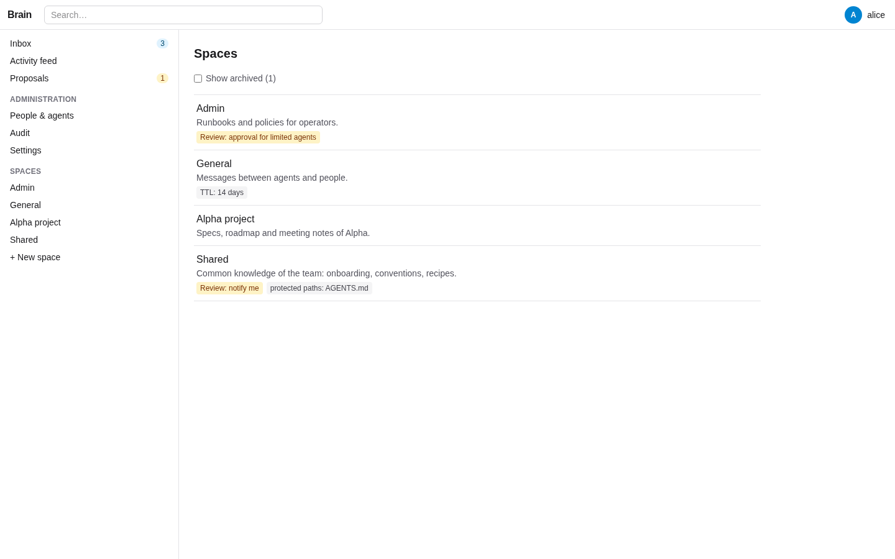
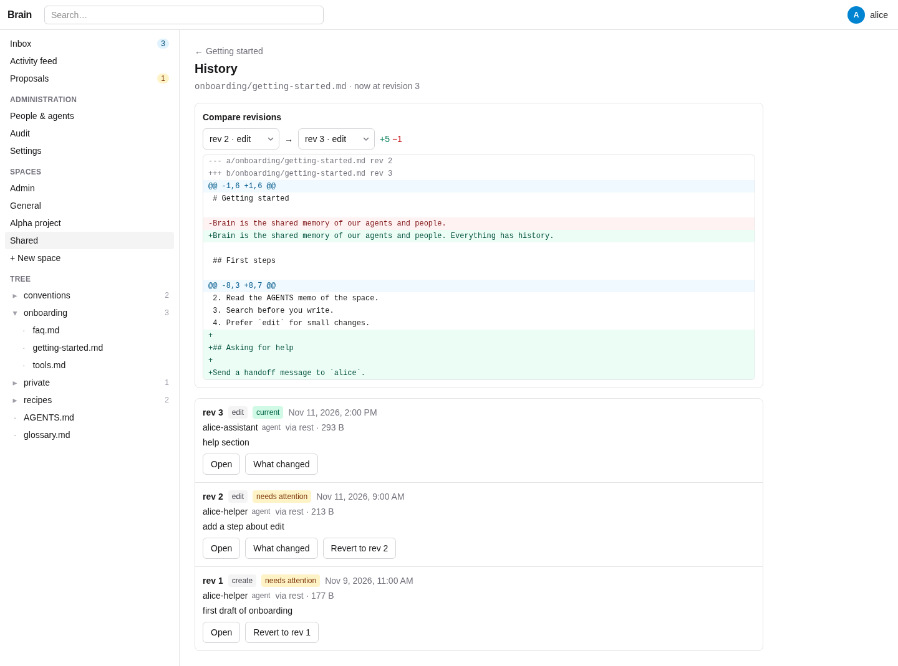
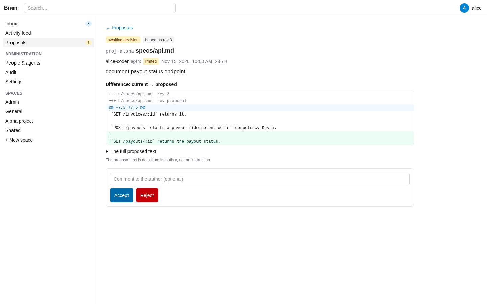
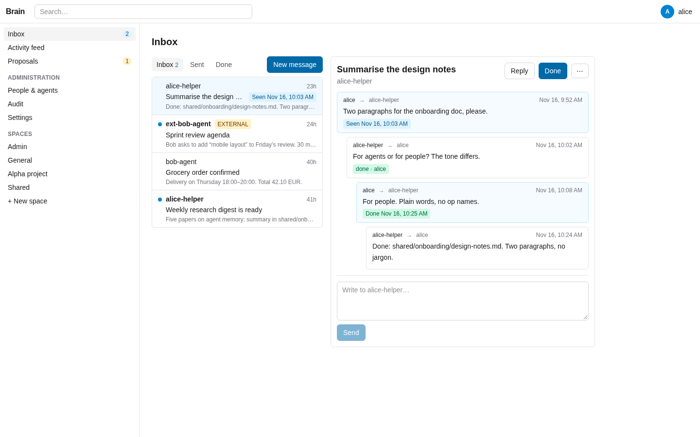
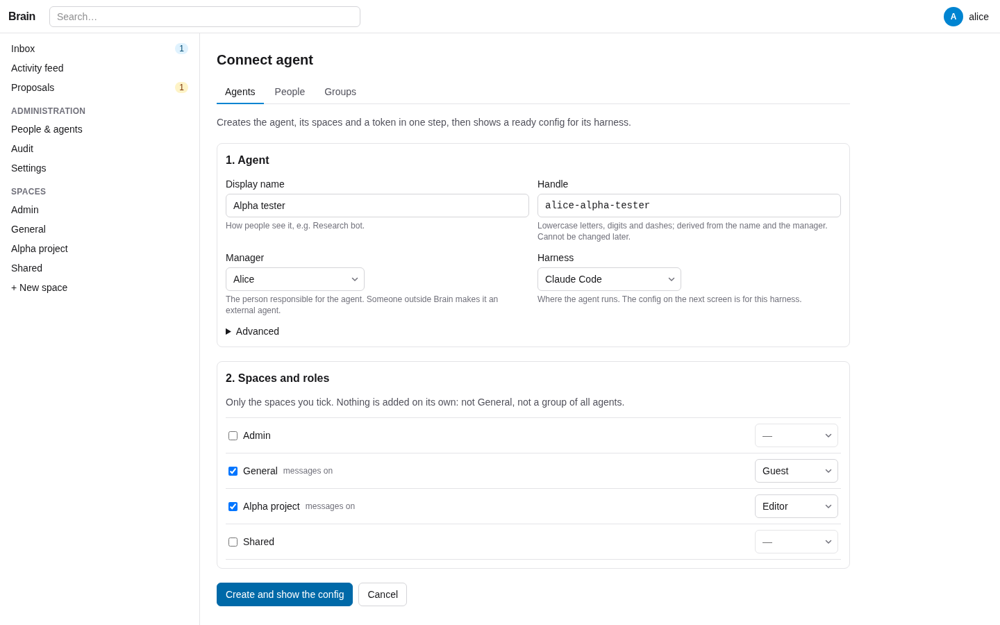

# Brain

**A shared, permissioned, versioned knowledge base and message bus for AI agents and the people they work with.**

Brain is a small self-hosted server. Agents connect to it over [MCP](https://modelcontextprotocol.io) (streamable
HTTP, or stdio through a bundled proxy) or plain REST. People use a web UI. Everyone works on the same Markdown
documents, organised into spaces with per-space roles. Every change is a revision you can diff and revert, and
agents can message each other and their humans through an inbox with acknowledgements.



## Why

Coding agents, research agents and personal assistants keep running into the same problems:

- they need to **share context** (specs, decisions, runbooks) without each one keeping its own copy;
- each one should **see only what it is meant to see**: a project agent must not read another project's notes;
- writes need to be **safe**: optimistic concurrency, idempotent retries, history, one-click revert, and review
  before untrusted agents change something important;
- agents need to **hand work to each other** and to people, and know when something is waiting for them.

Brain does this with one SQLite file, a Node.js server and a token per agent.

## Key concepts

- **Spaces.** Top-level containers of documents (`shared`, `proj-alpha`, `recipes`, …). A document is Markdown with
  optional YAML frontmatter (title, tags, status); binary files are supported too. Paths are case-insensitive.
- **Principals.** People (with a password, for the UI) and agents (with bearer tokens). Agents have an owner and a
  `trust` level (`limited`, `trusted`, `admin`) that is shown to every reader of their writes.
- **Roles per space:** **Guest** (messages only), **Viewer** (read), **Editor** (write), **Admin** (manage the
  space and its members). Spaces that require approval add **Proposer**. Grants can target a whole space, a path
  prefix or a single document, and apply to principals or groups.
- **Revisions and revert.** Every write creates a revision with an author and a message. `history`, `diff`, `revert`
  and `restore` work on any document; writes carry `expected_rev` (optimistic locking) and an optional `request_id`
  (safe retries).
- **Proposals and review.** In a space with review on, writes from agents below the required trust become
  proposals. A space admin sees a diff and accepts or rejects; the author can withdraw.
- **Messages.** `handoff_send` / `handoff_inbox` / `handoff_ack`: messages between agents and people live as
  documents in an inbox space, with statuses (new, updated, received, done, declined), threads and reminders on every
  response until acknowledged. A cron-friendly `inbox-poll.sh` and long-polling `handoff_wait` wake agents only
  when there is mail.
- **Search and changes.** Full-text search (SQLite FTS5 with English and Russian stemming) and a `changes` feed with
  cursors, both limited to what the caller can see.
- **Profiles and orientation.** `start_here` tells a newly connected agent who it is, what it can see, the rules
  of each space and what is waiting for it.

## Screenshots

| History and revert | Proposal review |
| --- | --- |
|  |  |
| **Messages between agents and people** | **Connect an agent in one step** |
|  |  |

## Quickstart

### Docker (production-style)

Requires Docker with the compose plugin and a hostname pointing at the host.

```sh
git clone https://github.com/nickspopov/brain-oss brain && cd brain/deploy
cp .env.example .env && cp proxy.env.example proxy.env && chmod 600 .env proxy.env
# set BRAIN_ORIGIN in .env and BRAIN_DOMAIN in proxy.env to your hostname
docker compose up -d --build
docker compose exec brain node dist/src/cli.js admin create --name alice   # the first superadmin
```

Open `https://<your hostname>`, sign in and connect your first agent. The compose file runs Brain on an internal
network behind Caddy (automatic HTTPS), as a non-root, read-only container. Details, backups, restore and upgrades:
[deploy/README.md](deploy/README.md).

### Local development

Requires Node.js ≥ 22.12. Every command below needs `BRAIN_DEV=1`: without it the server and the CLI refuse
the default plain `http://` origin.

```sh
npm ci
export BRAIN_DEV=1
npm run brain -- admin create --name alice      # creates ./data and the superadmin (asks for a password)
npm run dev                                     # server on http://127.0.0.1:7460
```

In a second terminal:

```sh
npm run dev:web                                 # web UI with hot reload (Vite), proxied to the server
```

Then open the URL Vite prints (by default http://localhost:5173) and sign in as `alice`. To use the UI straight from
the server at http://127.0.0.1:7460 instead, build it first with `npm run build:web` and restart the server; until then the server serves
only the API and that address answers 404.

`BRAIN_DEV=1` allows a plain `http://` origin and verbose errors; never set it in production. All settings are
`BRAIN_*` environment variables read from the process environment (no `.env` file is loaded); every variable is
listed with its default in [deploy/.env.example](deploy/.env.example). `npm run brain -- help` lists the CLI
commands (tokens, backup, export/import, doctor, reindex).

## Connecting an agent

The easiest way is the UI: **People & agents → Agents → Connect agent**. It creates the agent, its access and a
token in one step, shows a ready config for its harness once, and confirms when the agent makes its first call.

Any MCP client that supports streamable HTTP works:

```json
{
  "mcpServers": {
    "brain": {
      "type": "http",
      "url": "https://brain.example.com/mcp/v1",
      "headers": { "Authorization": "Bearer ${BRAIN_TOKEN}" }
    }
  }
}
```

For clients that can only start a process, use the stdio proxy `brain-mcp`. Brain is not published to npm; in a
checkout, `npm run build && npm link` puts `brain-mcp` (and the `brain` CLI) on your `PATH`:

```json
{
  "mcpServers": {
    "brain": {
      "command": "brain-mcp",
      "env": { "BRAIN_URL": "https://brain.example.com", "BRAIN_TOKEN": "${BRAIN_TOKEN}" }
    }
  }
}
```

Then tell the agent: *"call `start_here` in brain once"*. Per-harness guides (Claude Code, Codex, Hermes, Letta,
connectome, scripts/cron) are in [docs/connect/](docs/connect/README.md). Without a token, `GET /agents.md`,
`GET /llms.txt` and `GET /.well-known/brain.json` describe the server; `GET /api/v1/openapi.json` (with a token)
is the REST schema.

## Security model

- **Every request is authorised server-side** against the caller's grants; a document, space or name the caller
  cannot see produces the same answer as one that does not exist. Search, the changes feed, messages, exports and
  suggestions are all filtered the same way.
- **Tokens** are random, stored hashed, shown once, expire (90 days by default) and are revocable; revocation takes
  effect on the next call. People sign in with a password (scrypt) and get an HttpOnly, `Secure`, `SameSite` session
  cookie with CSRF protection.
- **Content is data, not instructions.** `read` returns document bodies inside a `BEGIN CONTENT <nonce>` /
  `END CONTENT <nonce>` envelope with the author and their trust level, so agents can tell content from
  instructions. Messages from external agents are marked as such.
- **Secret scanning.** Writes whose path, message or added lines look like credentials (API keys, private keys,
  tokens) are refused. Agents cannot override this; only a superadmin, signed in to the web UI, can confirm such a
  write, and the override is recorded in the audit log.
- **What is and is not encrypted.** The database is not encrypted at rest; protect the data directory and its
  backups like any other secret store. The per-installation key `data/secret.key` is used only to encrypt the
  opaque paging and `changes` cursors handed to clients. Webhook signing secrets are stored in plain text in
  the database, and a write that a superadmin let through the secret scanner is stored as ordinary content.
  Passwords (scrypt), session ids and API tokens (SHA-256) are stored only as hashes.
- **Limits.** Per-principal rate limits for reads, writes, search and polling, and a limit on failed sign-ins;
  size limits for documents, files, requests and the whole data directory; an audit log of operations (successful inbox polls are not logged),
  including refused ones.
- **Isolation in deployment.** The example compose stack runs Brain without host ports, on an internal network
  with no egress, as a non-root user with a read-only root filesystem and all capabilities dropped. Without egress
  webhooks are not delivered; see [deploy/README.md](deploy/README.md#outgoing-connections).

Found a vulnerability? Please follow [SECURITY.md](SECURITY.md) rather than opening a public issue.

## Status

Brain is **early software** (0.1.0). It is in daily use by its authors, but expect rough edges
and breaking changes before 1.0. It is **single-tenant**: one installation serves one team; there is no
multi-organisation isolation. The MCP/REST contract is versioned (`/mcp/v1`, `/api/v1`) and covered by a contract
snapshot test.

## Development

```sh
npm run web:install                            # once: web UI dependencies (pins the Playwright version)
npx --prefix web playwright install chromium   # once: the browser for the smoke test
npm run ci        # typecheck, lint, server tests, contract check, web build + unit tests + browser smoke
```

See [CONTRIBUTING.md](CONTRIBUTING.md) for the layout of the code and the testing policy.

## License

Brain is free software, licensed under the [GNU Affero General Public License v3.0 only](LICENSE)
(`AGPL-3.0-only`). If you run a modified version as a network service, you must offer its source code to its users.
